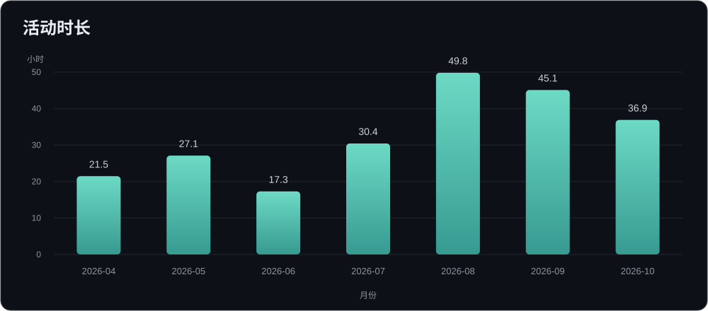

# Hi, I'm via2004 👋

## Coding & AI activity

AI 编程历史与近期活动：本地日志回溯历史，WakaTime 每日统计持续更新。

<!--START_SECTION:waka-->
### 历史足迹



历史回溯：**2026-04-04 — 2026-10-21**。按本地 Codex 日志估算；之后的活动按天保存，持续累计。

<details><summary>统计口径与历史数据</summary>

- 合并同一会话的所有日志片段；相邻活动间隔不超过 15 分钟时计入时长，并行会话的重叠时间只算一次。
- 此历史时长为活动估算，不代表精确工时；没有日志的时段不推算。
- 从历史回溯截止日之后接入 WakaTime 每日统计，两段按日期分开，不重复相加。
- 旧日志不用于推算此前未采集的人工编程时间。
- [历史汇总](data/history-baseline.json) · [每日统计归档](data/daily-stats.json)

</details>

### 最近活动

**最近 7 天（含今天）：2026-10-16 — 2026-10-22 · Asia/Shanghai**

⏱ 编程活动：**5 小时 48 分钟**

🤖 AI Coding：**5 小时 48 分钟**

✍️ AI 新增 **1,344** 行 · 删除 **2** 行

🧑‍💻 已采集的人工新增 **0** 行 · 删除 **0** 行

🔤 输入 Token：**3,182,908** · 缓存输入：**113,653,248** · 输出：**265,682**

💬 提示次数：**99**

💵 按 Token 估算费用：**$132.19**（非订阅账单）

**语言**

```text
Other  3 小时 36 分钟  ████████████░░░░░░░░ 62.3%
Go  1 小时 16 分钟  ████░░░░░░░░░░░░░░░░ 22.0%
Markdown  42 分钟  ██░░░░░░░░░░░░░░░░░░ 12.3%
YAML  6 分钟  ░░░░░░░░░░░░░░░░░░░░ 1.9%
Python  3 分钟  ░░░░░░░░░░░░░░░░░░░░ 0.9%
```

**编辑器 / AI 工具**

```text
Codex Vscode  5 小时 41 分钟  ████████████████████ 98.1%
Cursor  6 分钟  ░░░░░░░░░░░░░░░░░░░░ 1.9%
```

<sub>历史回补只涵盖采集器实际读取的记录；此前未安装编辑器采集插件的人工编程活动无法补齐。</sub>

最后更新：2026-10-22 00:10:56（北京时间）
<!--END_SECTION:waka-->

<sub>AI 行数为采集到的新增量；AI 用时依照 WakaTime 活动统计口径；费用为估算值。</sub>
