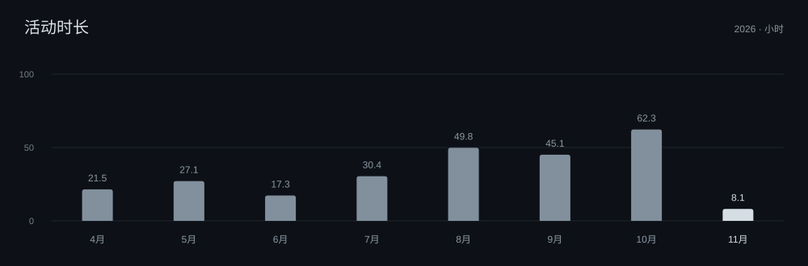

# Hi, I'm via2004 👋

## Coding & AI activity

AI 活动时长由本机日志持续汇总；代码行数、Token 等明细来自 WakaTime。

<!--START_SECTION:waka-->


<details><summary>统计口径与历史数据</summary>

本地日志记录：**2026-04-04 — 2026-11-06**。历史与新增数据使用相同的 AI 活动时长估算方法。

- 合并同一会话的所有日志片段；相邻活动间隔不超过 15 分钟时计入时长，并行会话的重叠时间只算一次。
- 此历史时长为活动估算，不代表精确工时；没有日志的时段不推算。
- 每天北京时间 08:00 合并日志并同步汇总，错过时在下次用户服务启动后补跑；同步后自动刷新主页。不会把 WakaTime 时长再次相加。
- 不包括未留下活动记录的查资料、思考等时间；本机离线期间主页保持上次同步值。
- 旧日志不用于推算此前未采集的人工编程时间。
- [本地活动汇总](data/codex-activity.json) · [WakaTime 采集归档](data/daily-stats.json)

</details>

### 最近活动

**最近 7 天（含今天）：2026-11-01 — 2026-11-07 · Asia/Shanghai**

⏱ AI 活动时长（本地日志估算）：**18 小时 41 分钟**

**WakaTime 采集明细**

<sub>以下行数、Token 和费用仅覆盖 WakaTime 识别到的活动，可能漏掉续接日志。明细日期：2026-11-01 — 2026-11-07；采集更新：2026-11-07 10:52:48 CST。</sub>

✍️ AI 新增 **921** 行 · 删除 **9** 行

🧑‍💻 已采集的人工新增 **166** 行 · 删除 **22** 行

🔤 输入 Token：**12,663,249** · 缓存输入：**335,318,656** · 输出：**816,617**

💬 提示次数：**207**

💵 按 Token 估算费用：**$502.78**（非订阅账单）

**语言**

```text
Other  7 小时 4 分钟  ██████████░░░░░░░░░░ 48.6%
Go  4 小时 42 分钟  ██████░░░░░░░░░░░░░░ 32.3%
TeX  52 分钟  █░░░░░░░░░░░░░░░░░░░ 6.0%
Markdown  40 分钟  █░░░░░░░░░░░░░░░░░░░ 4.7%
Python  39 分钟  █░░░░░░░░░░░░░░░░░░░ 4.5%
```

**编辑器 / AI 工具**

```text
Cursor  11 小时 25 分钟  ████████████████░░░░ 78.4%
Codex Vscode  3 小时 5 分钟  ████░░░░░░░░░░░░░░░░ 21.2%
Codex CLI  3 分钟  ░░░░░░░░░░░░░░░░░░░░ 0.4%
```

<sub>此前未安装编辑器采集插件的人工编程活动无法补齐。</sub>

最后更新：2026-11-07 10:52:48（北京时间）
<!--END_SECTION:waka-->

<sub>AI 行数为采集到的新增量；AI 用时依照 WakaTime 活动统计口径；费用为估算值。</sub>
